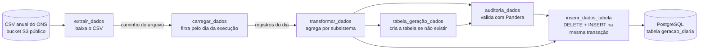
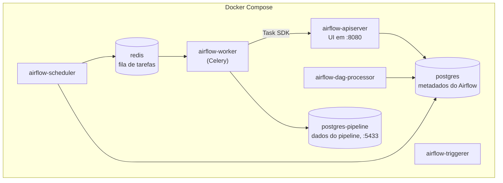

# Pipeline ETL de Energia com Apache Airflow


Pipeline de dados orquestrado com **Apache Airflow 3**: extrai o balanço de energia por subsistema do
**ONS** (Operador Nacional do Sistema Elétrico), valida a qualidade com **Pandera** e carrega num
**PostgreSQL** de forma **idempotente**, com retry, backfill histórico e testes automatizados.

Projeto de portfólio e estudo, e meu primeiro projeto de orquestração com Airflow.

## A pergunta que o pipeline responde

> Qual percentual da energia gerada no Brasil foi renovável, por dia, em cada subsistema?

Para cada dia, o pipeline entrega uma linha por subsistema (Norte, Nordeste, Sul, Sudeste/Centro-Oeste e o
total nacional como referência), com a geração total, a geração renovável (hidráulica, eólica e solar) e o
percentual renovável.

## Como funciona

### Fluxo da DAG `ONS_energia`



| Task | O que faz |
|---|---|
| `extrair_dados` | Baixa o CSV anual do ONS em streaming e grava em disco. O XCom carrega **só o caminho** do arquivo, nunca o dado bruto. |
| `carregar_dados` | Lê o CSV, converte `din_instante` de `America/Sao_Paulo` para UTC e filtra as linhas do dia da execução (`ds`). Se não houver dado, **falha de propósito**. |
| `transformar_dados` | Soma a geração por linha, tira a média por subsistema e só então calcula o `pct_renovavel` a partir das médias. |
| `auditoria_dados` | Valida o resultado com um schema Pandera (`lazy=True`, reporta todas as violações juntas). Dado ruim derruba a task. |
| `tabela_geração_dados` | `CREATE TABLE IF NOT EXISTS` com chave primária `(data_execucao, nom_subsistema)`. |
| `inserir_dados_tabela` | Apaga as linhas daquela data e insere as novas, **numa única transação**. |

### Arquitetura dos contêineres



## Stack

| Camada | Tecnologia |
|---|---|
| Orquestração | Apache Airflow 3.3.1 (TaskFlow API, CeleryExecutor) |
| Processamento | Python 3.13 (imagem oficial), pandas |
| Qualidade de dados | Pandera 0.34.0 |
| Armazenamento | PostgreSQL 16 (dois serviços: metadados e dados) |
| Fila | Redis 7.2 |
| Infraestrutura | Docker Compose, imagem estendida via Dockerfile |
| Testes e CI | pytest 9.1.1, GitHub Actions |

## Como rodar

**Pré-requisitos:** Docker com Compose v2 e cerca de 4 GB de RAM liberados para o Docker (o conjunto consome
perto de 2 GB em uso).

1. **Clone o repositório** e entre na pasta.

2. **Crie o `.env`** a partir do modelo e preencha os valores (o arquivo explica cada variável, inclusive
   como gerar a `FERNET_KEY`):
   ```bash
   cp .env.example .env
   ```

3. **No Linux ou macOS**, crie as pastas que o Compose monta (evita que o Docker as crie como root):
   ```bash
   mkdir -p data config plugins
   ```

4. **Suba o ambiente.** Na primeira vez, o `airflow-init` cria as tabelas de metadados e o usuário admin:
   ```bash
   docker compose up -d --build
   ```

5. **Abra a interface** em http://localhost:8080 e entre com o usuário e a senha definidos no `.env`.

6. **Ative a DAG.** Toda DAG nasce pausada. Pela interface (botão da `ONS_energia`) ou pelo terminal:
   ```bash
   docker compose exec airflow-scheduler airflow dags unpause ONS_energia
   ```
   Como a DAG tem `catchup=True` e `start_date` em 01/01/2026, o scheduler cria sozinho uma execução para cada
   dia desde então, **5 por vez** (`max_active_runs=5`). Acompanhe pela aba **Grid** da DAG.

7. **Confira o dado** (use o usuário e o banco definidos no `.env`):
   ```bash
   docker compose exec postgres-pipeline psql -U pipeline -d pipeline \
     -c "SELECT data_execucao, nom_subsistema, round(pct_renovavel::numeric, 1) AS pct FROM geracao_diaria ORDER BY 1, 2 LIMIT 10;"
   ```

8. **Rode os testes:**
   ```bash
   docker compose exec airflow-scheduler python -m pytest /opt/airflow/tests -v
   ```

### Reprocessar um intervalo de datas

O `catchup` só preenche o que ainda está pendente no momento em que é avaliado. Para reprocessar um intervalo
de propósito, use o backfill explícito (ajuste `--to-date` para a última data que o ONS já publicou):

```bash
docker compose exec airflow-scheduler airflow backfill create \
  --dag-id ONS_energia --from-date 2026-01-01 --to-date 2026-10-11 \
  --max-active-runs 5 --reprocess-behavior failed
```

Use `--dry-run` primeiro para ver quais datas seriam criadas.

## Decisões de arquitetura

| Decisão | Motivo | Custo aceito |
|---|---|---|
| **Airflow 3.x**, não 2.x | `api-server` e `dag-processor` separados e *task isolation*: o worker fala com a API, não com o banco de metadados | A maior parte dos tutoriais é da 2.x e traz código que não funciona mais |
| **Dois PostgreSQL** | O de metadados é da infraestrutura do Airflow; misturar o dado do pipeline nele acopla os dois | Um serviço a mais no Compose |
| **Fonte com dimensão de data** (CSV anual do ONS) | Idempotência e backfill só são demonstráveis se cada execução tiver uma fatia própria de dado | O arquivo do ano inteiro é baixado a cada execução (cerca de 3,5 MB) |
| **`ds` como chave de partição, tudo em UTC** | Evita o bug silencioso de carregar o dia errado. O horário do CSV é localizado em `America/Sao_Paulo` e convertido para UTC antes de filtrar | Conversão explícita dentro da task |
| **XCom só com caminho ou registros pequenos, sem pickle** | XCom é uma linha no banco de metadados, e pickle é risco de segurança | Só tipos serializáveis em JSON (um `Timestamp` precisa virar texto antes do `return`) |
| **Agregar primeiro, calcular o percentual depois** | Média de percentuais distorce: duas linhas de 100% (total 100) e 0% (total 300) dão 25% pelas médias e 50% pela média dos percentuais. Há teste cobrindo esse caso | Nenhum |
| **Falhar de propósito sem dado do dia** | Dado vazio vazando gera um erro confuso lá na frente. Melhor falhar alto, no lugar certo | Os dias mais recentes ficam como `failed` até o ONS publicar |
| **Pandera com `lazy=True`** | Um relatório com todas as violações, não só a primeira | Nenhum |
| **Carga idempotente: DELETE + INSERT por data, numa transação** | Rodar duas vezes a mesma data dá o mesmo resultado; o `ROLLBACK` evita deixar um dia pela metade | Reescreve o dia inteiro em vez de um UPSERT linha a linha |
| **Queries parametrizadas** (`%s`) | O driver faz o escape do valor, eliminando SQL injection | Nenhum |
| **Connection por variável de ambiente** (`AIRFLOW_CONN_PIPELINE_DB`) | Sem passo manual escondido na interface; a senha fica fora do código | Segredo em `.env` local (em produção, usar um Secrets Backend) |
| **Imagem estendida por Dockerfile, versões fixas** | Dependências reproduzíveis; imagem base fixada em `3.3.1`, nunca `latest` | Rebuild ao mudar uma dependência |
| **`catchup=True` + backfill explícito** | O catchup é automático; o comando de backfill cobre intervalos que o catchup não alcança | Duas ferramentas para entender (ver aprendizados) |
| **`max_active_runs=5`** | Limita quantas execuções rodam ao mesmo tempo, para não sobrecarregar a máquina durante o backfill | Backfill mais lento do que sem limite |
| **Linha `SISTEMA INTERLIGADO NACIONAL` mantida** | Serve de referência do total do país ao lado de cada região | Não é um quinto subsistema comparável: já soma os outros |
| **Postgres do pipeline publicado só em `127.0.0.1:5433`** | Dá para consultar com um cliente SQL sem expor o banco na rede local | Nenhum |
| **Testes e CI rodando na própria imagem do projeto** | Mesmo ambiente do desenvolvimento; evita instalar o Airflow com arquivo de constraints no runner | Build da imagem a cada execução do CI |

## Confiabilidade

- **Idempotência:** a mesma data processada duas vezes mantém exatamente as mesmas linhas, comprovado
  rodando a data duas vezes e contando as linhas no banco. A chave primária `(data_execucao, nom_subsistema)`
  também impede duplicatas por construção.
- **Retry:** `retries=3` com `retry_delay` de 5 minutos, testado com falha forçada (uma regra do Pandera foi
  apertada de propósito: a auditoria falhou na primeira tentativa e passou na segunda, com a regra restaurada).
- **Qualidade de dado:** a auditoria falha a task em vez de deixar dado ruim chegar ao banco.
- **Backfill:** execução de referência processou cerca de 280 dias (01/01 a 11/10/2026), 5 por vez, sem
  nenhuma falha dentro do intervalo.

## Testes e CI

Os testes rodam dentro do contêiner do Airflow e cobrem quatro níveis:

| Nível | O que garante |
|---|---|
| Integridade | A pasta `dags/` carrega pelo `DagBag` sem nenhum erro de import |
| Estrutura | A DAG `ONS_energia` existe e tem exatamente as 6 tasks esperadas |
| Dependências | A ordem do grafo está correta, incluindo "a tabela é criada antes do INSERT" |
| Lógica | O cálculo do `pct_renovavel` (agregar antes de dividir) bate com o valor calculado à mão |

Um teste que só passa não prova que consegue falhar, então o de integridade também foi verificado com um
arquivo de DAG quebrado de propósito: ele falhou apontando o arquivo e a linha do erro.

O workflow [`.github/workflows/testes.yml`](.github/workflows/testes.yml) roda a cada `push` na `main`: constrói a
imagem do `Dockerfile` e executa o pytest dentro dela.

## Fonte de dados

Dataset público **Balanço de Energia nos Subsistemas** do ONS, em CSV anual, com granularidade horária por
subsistema (geração hidráulica, térmica, eólica e solar, em MWmed), atualizado diariamente e sem autenticação.

Arquivo usado pelo pipeline:
`https://ons-aws-prod-opendata.s3.amazonaws.com/dataset/balanco_energia_subsistema_ho/BALANCO_ENERGIA_SUBSISTEMA_2026.csv`

## Estrutura do repositório

```text
.
├── dags/hello_energia.py          # DAG ONS_energia (6 tasks)
├── tests/test_dags.py             # integridade, estrutura, dependências e lógica
├── Dockerfile                     # estende apache/airflow:3.3.1 (pandera, pytest)
├── docker-compose.yaml            # Airflow (Celery) + 2 PostgreSQL + Redis
├── .env.example                   # modelo das variáveis de ambiente
├── .github/workflows/testes.yml   # CI
├── data/                          # CSV baixado em runtime (fora do Git)
└── config/ plugins/               # pastas montadas pelo Compose
```

## Limitações conhecidas

- **Atraso de publicação do ONS:** o dado de um dia só aparece cerca de 3 dias depois. As execuções dos dias
  mais recentes falham de propósito (e esgotam os 3 retries) até o dado ser publicado.
- **Fonte fixa em 2026:** o endereço do CSV está configurado para o arquivo anual de 2026. Processar outro ano
  exige parametrizar a URL.
- **Ambiente de estudo, não de produção:** credenciais vêm de um `.env` local, e a porta da interface é publicada
  em todas as interfaces, como no Compose oficial do Airflow.
- **O Airflow não importa no Windows nativo** (usa funções exclusivas de Unix): o desenvolvimento e os testes
  rodam sempre dentro dos contêineres.
- **Cada execução baixa o CSV inteiro**, o que é simples, mas desperdiça tráfego em backfills grandes.

## Aprendizados que não estavam nos tutoriais

- **Baixar o `start_date` de uma DAG que já tem histórico não refaz o passado.** O scheduler guarda um
  ponteiro de "próxima execução" que só avança, e intervalos descartados com `catchup=False` não voltam ao
  ligar `catchup=True` depois. O comando `airflow backfill create` resolve esse caso.
- **Um teste de dependências encontrou um bug real:** a carga não dependia da criação da tabela. Funcionava
  só porque a tabela já existia, e num banco novo as duas tasks competiriam.
- **Material desatualizado custa tempo:** parâmetros como `include_examples` do `DagBag` existiam na 2.x e
  não existem na 3.x. Perguntar à versão instalada (`inspect.signature`) é mais rápido que procurar outra receita.

## Próximos passos

Sensor para esperar a publicação do dado em vez de falhar, formato Parquet no lugar do CSV, alerta com
`on_failure_callback` e parametrização do ano da fonte.

---

Feito por [Samuel Pires](https://github.com/SamuelzinPires).
